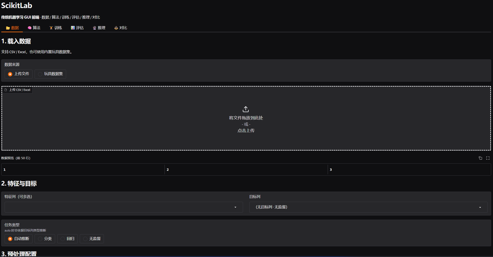

# ScikitLab

传统机器学习 GUI 前端。基于 **scikit-learn + Gradio** 构建，运行时自动发现 scikit-learn 中的全部估计器，
提供“数据载入 → 算法选择 → 参数配置 → 训练监控 → 诊断评估 → 模型保存 → 推理”完整闭环。

面向学生、科研人员与算法工程师：**开箱即用、零代码配置、参数自动生成、训练过程可视**。



---

## 核心特性

- **算法全覆盖**：运行时扫描 `sklearn` 命名空间，凡有 `fit` 方法的公开估计器自动收录；
  scikit-learn 版本升级新增估计器时无需改代码。
- **参数面板自动生成**：每个估计器的 `__init__` 签名被解析成 Gradio 组件，默认值、类型、
  枚举候选全部自动推断。
- **双模训练可视**：
  - 支持 `partial_fit` 的算法（`SGDClassifier`、`Perceptron`、`PassiveAggressive*` 等）
    每个 epoch 实时更新损失/指标曲线；
  - 批量算法（`RandomForest`、`SVC`、`GradientBoosting` 等）训练结束后一次性呈现诊断视图与
    内禀 `train_score_` 曲线。
- **完整模型持久化**：`joblib` 保存拟合后的估计器（含学习参数），JSON 保存训练前参数快照、
  数据 schema、指标历史、sklearn 版本。
- **分任务诊断图**：分类出混淆矩阵 + ROC 曲线 + 分类报告；回归出预测-真实散点 + 残差图 +
  MSE/MAE/R²；聚类出簇大小分布；有 `feature_importances_` / `coef_` 的模型自动出特征重要性图。
- **单条 + 批量推理**：单条按模型 `feature_names` 动态生成输入表单；批量接受 CSV，
  输出预测列与各类概率列，完整结果可下载。

---

## 快速启动（Windows）

```cmd
:: 1. 从父目录克隆或放置项目文件夹后进入
cd ScikitLab

:: 2. 创建虚拟环境
python -m venv .venv
call .venv\Scripts\activate.bat

:: 3. 安装依赖
pip install gradio scikit-learn pandas numpy joblib openpyxl matplotlib

:: 4. 启动
python app.py
```

访问 `http://127.0.0.1:7860`。

依赖版本要求：

| 包 | 最低版本 | 说明 |
|---|---|---|
| Python | 3.10+ | `@gr.render` 与 `match` 语法依赖 |
| gradio | 4.16+ | `@gr.render` 动态渲染 |
| scikit-learn | 1.3+ | `all_estimators` 兼容层 |
| pandas / numpy / joblib / matplotlib | 最新稳定版 | — |
| openpyxl | 最新稳定版 | 读取 Excel 必需 |

---

## 典型工作流

1. **📂 数据页**
   - 上传 CSV / Excel，或选择内置玩具数据集（Iris / Wine / Breast Cancer / Digits / Diabetes）。
   - 选择特征列与目标列；任务类型默认自动推断（分类 / 回归 / 无监督），可手动覆盖。
   - 划分训练/测试集：**分层抽样**（推荐）/ 随机 / 顺序切片。
   - 点击【划分并准备训练】，界面显示 `DatasetBundle` 摘要与类别分布对照表。
2. **🧠 算法页**
   - 从下拉框选择算法（按任务类型过滤，meta 估计器不展示）。
   - 参数面板自动生成；`estimator` 字段（可独立使用的包装类如 `RandomForestClassifier`）
     已锁定为“使用 sklearn 内置默认子估计器”。
   - 点击【✅ 确认参数并保存】。
3. **🏋 训练页**
   - 设置 `epochs` / `batch_size`（仅增量算法生效，批量算法显式提示）。
   - 点击【🚀 开始训练】。增量算法曲线逐 epoch 更新；批量算法训练完成后一次性展示。
   - 训练完成后输入模型名，点击【💾 保存当前模型】，生成 `artifacts/saved_models/<name>.joblib`
     与 `<name>.json`。
4. **📊 评估页**
   - 选择测试集 / 训练集，点击【🔍 生成诊断图】。
   - 分类：混淆矩阵 + ROC + 分类报告 + 特征重要性。
   - 回归：预测-真实散点 + 残差图 + MSE/MAE/R² + 特征重要性。
5. **🔮 推理页**
   - 刷新模型列表 → 选择模型 → 点击【📂 载入模型】。
   - 单条推理：动态生成特征输入框，点击【🔮 预测】显示类别与概率分布。
   - 批量推理：上传列名与 `feature_names` 一致的 CSV，输出预测列与概率列，完整结果可下载。

---

## 目录结构

```
ScikitLab/
├── app.py                       # Gradio Blocks 入口（含页脚）
├── requirements.txt
├── README.md
├── .gitignore
│
├── core/                        # 与 UI 解耦的核心层（可独立测试）
│   ├── registry.py              # 算法自动发现、参数元数据提取
│   ├── params.py                # 参数组件构建与值转换
│   ├── dataset.py               # DatasetBundle、载入、划分、任务推断
│   ├── trainer.py               # TrainingSession、批量/增量训练生成器
│   └── persistence.py           # joblib + JSON 双轨模型保存/载入
│
├── ui/                          # Gradio 页面层
│   ├── page_data.py
│   ├── page_algorithm.py
│   ├── page_train.py
│   ├── page_evaluate.py
│   └── page_predict.py
│
├── artifacts/                   # 运行时生成（已 gitignore）
│   ├── saved_models/            # <name>.joblib + <name>.json
│   └── uploads/                 # 批量推理结果 CSV
│
└── tests/                       # unittest 测试套件
    ├── test_registry.py
    ├── test_params.py
    ├── test_dataset.py
    ├── test_trainer.py
    ├── test_persistence.py
    ├── test_algorithm_page.py
    ├── test_train_page.py
    ├── test_evaluate_page.py
    ├── test_predict_page.py
    └── test_footer.py
```

---

## 运行测试

```cmd
call .venv\Scripts\activate.bat
python -m unittest discover -s tests -t . -v
```

测试套件覆盖：算法注册表发现与元数据、参数双向转换、数据集构建与推断、训练引擎批量/增量双路径、
模型保存-载入-预测一致性、各页辅助函数、页脚环境快照。

---

## 已知边界与限制

**元估计器不在 UI 中展示。** `GridSearchCV`、`VotingClassifier`、`StackingClassifier`、`RFE`、
`SelectFromModel` 等需要用户显式提供嵌套估计器实例的类，参数面板无法构造，当前版本不在算法下拉框中出现。
它们仍在注册表中（`is_meta=True`），可在未来通过“嵌套估计器选择器”单独开放。

**非数值特征暂不支持。** 数据页只接受数值特征列。字符串/类别型特征需要在导入前手工做独热编码或标签编码，
或未来通过“预处理管道”模块扩展。

**顺序切片可能导致类别不相交。** 当数据按类别排序（如 `sklearn.datasets.load_iris`）时，
选择“顺序切片”会造成测试集缺失部分类别。数据页会在类别分布表中显示 `⚠ 训练集缺失类别` /
`⚠ 测试集缺失类别` 警告，但**不会阻塞**用户操作。

**批量算法无法逐步推送损失。** `RandomForest`、`SVC`、`GradientBoosting` 等批量估计器的 `fit`
是一个不可分割调用，Gradio 无法从内部逐步 `yield`。训练页会显式提示“批量算法，期间无法逐步推送指标”，
训练结束后一次性呈现完整诊断视图与内禀 `train_score_` 曲线。

**取消训练的语义分层。** 增量算法在下一个 epoch 边界退出；批量算法必须等 `fit` 返回后才生效，
返回结果会被丢弃。

**页脚是启动快照。** 保存新模型后页脚“已保存模型”数量不会自动更新，需要在推理页刷新列表确认最新模型。

**模型载入的版本兼容性。** 载入时若 sklearn 版本与保存时不一致，会给出警告但不阻止——不同小版本通常兼容，
跨大版本存在 pickle 序列化变化的风险。

---

## 二次开发指引

- **新增页面**：在 `ui/` 下创建 `page_xxx.py`，导出 `build(...)` 函数，在 `app.py` 的 `gr.Tabs()`
  中挂载，`gr.State` 在 `Blocks` 顶层定义后传入。
- **扩展算法来源**：`core/registry.py` 的 `_iter_sklearn_modules` 当前只扫描 `sklearn` 命名空间。
  如需覆盖 `xgboost` / `lightgbm` 等第三方包，扩展该函数即可，参数面板会自动跟随。
- **自定义参数控件**：`core/params.py` 的 `build_component` 与 `coerce_value` 是唯一的适配点，
  新增控件类型（如 `gr.Slider` 用于数值范围）时同步扩展这两处即可。
- **新增持久化格式**：`core/persistence.py` 的 `ModelMetadata` 是 JSON 的 schema 定义，
  新增元数据字段只需在 dataclass 中加字段并保持向后兼容（旧 JSON 缺字段用默认值填充）。

---

## 许可证

内部教学/科研项目示例，未附带强制许可证。使用第三方依赖遵循各库自身许可（scikit-learn BSD-3-Clause、
Gradio Apache-2.0、pandas BSD-3-Clause、numpy BSD-3-Clause、matplotlib PSF-based）。

---

## 验证步骤

在项目根目录 `F:\project\ScikitLab\` 下：

```cmd
:: 1. 写入两个文件（用你惯用的编辑器：notepad / VS Code / 其他）
notepad README.md
notepad .gitignore

:: 2. 激活虚拟环境
call .venv\Scripts\activate.bat

:: 3. 全量测试回归（应保持 61 个全部 ok）
python -m unittest discover -s tests -t . -v

:: 4. 启动应用，确认页脚与所有 Tab 正常
python app.py
```

预期：

- **测试**：61 个全部 `ok`；
- **`.gitignore` 生效验证**（若项目已 `git init`）：
  ```cmd
  git status --short
  ```
  `artifacts/`、`.venv/`、`__pycache__/`、`*.joblib` 均不出现在未跟踪文件列表中；
- **`README.md`**：用 Markdown 预览器打开，检查表格、代码块、目录结构是否正确渲染；
- **`app.py`**：页面底部页脚三行正常显示，五个 Tab 都可交互。

